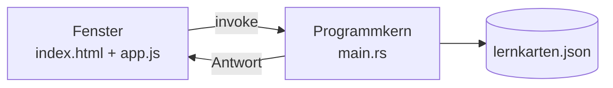

# K5 – Daten behalten

## Inhaltsübersicht

- Das Problem: nach dem Schließen ist alles weg
- Warum eine Webseite das nicht darf
- Die zwei Teile einer Desktop-Anwendung
- Der vorbereitete Programmkern
- Der erste Aufruf
- Laden beim Start
- Speichern an den richtigen Stellen
- Absichtlicher Fehler: das fehlende `await`
- Typische Stolperstellen
- Stand am Ende des Moduls

Bis jetzt sind alle Karten nach dem Schließen weg. Hier kommt die Brücke zum Rust-Teil ins Spiel und die Karten landen in einer Datei. Das ist der Punkt, an dem sich die Anwendung von einer Webseite unterscheidet.

> [!note] Rust wird nicht unterrichtet
> Die Datei `main.rs` ist vollständig vorbereitet und wird nur gemeinsam gelesen. Es geht darum zu verstehen, **dass** es einen zweiten Teil gibt und wie man ihn anspricht. Nicht darum, ihn zu schreiben.

## Das Problem: nach dem Schließen ist alles weg

Anwendung schließen, neu starten. Alle Karten sind weg.

Das Problem wird **erlebt, bevor es gelöst wird**. Der Kurs startet hier mit einem Blick auf das, was fehlt.

## Warum eine Webseite das nicht darf

Die Frage an die Gruppe: *Warum kann eine Webseite das nicht?*

Antwort ohne Fachbegriffe: Weil eine Webseite von einem fremden Server kommt und nicht in die Dateien des Rechners schreiben können soll. Eine installierte Anwendung darf das, weil sie bewusst installiert wurde.

> [!tip] Warum das ein Unterschied ist
> Eine Webseite ist ein Gastsucher. Eine installierte Anwendung ist eingezogen und hat einen Schlüssel für die Schränke. Der Unterschied ist nicht die Technik, sondern die Erlaubnis.

## Die zwei Teile einer Desktop-Anwendung



Das Fenster ist das, was man sieht: HTML, CSS und JavaScript. Der Programmkern ist das, was man nicht sieht: er darf auf die Festplatte zugreifen.

Bis jetzt lief alles im Fenster. Ab jetzt ruft das Fenster den Programmkern und bittet ihn, etwas zu tun.

## Der vorbereitete Programmkern

`src-tauri/src/main.rs` enthält zwei Funktionen. Sie werden gemeinsam gelesen und Zeile für Zeile in normalem Deutsch beschrieben. Es wird nichts daran verändert.

| Funktion | Was sie tut |
|---|---|
| `karten_speichern(karten)` | schreibt die Liste als JSON in `lernkarten.json` im Anwendungsdatenordner |
| `karten_laden()` | liest die Datei und gibt die Liste zurück; fehlt die Datei, gibt sie eine leere Liste zurück |

> [!note] Warum nicht das Datei-Plugin von Tauri?
> Die Tauri-Plugins liegen als npm-Pakete vor und brauchen einen Bundler. Der Kurs kommt ohne Node aus. Zwei vorbereitete Rust-Commands sind der einfachere und für die Teilnehmenden verständlichere Weg.

## Der erste Aufruf

```js
async function speichern() {
  await window.__TAURI__.core.invoke("karten_speichern", { karten: karten });
  console.log("gespeichert");
}
```

Drei Dinge werden als **Rezept** eingeführt, nicht als Konzept:

| Wort | Rezeptregel |
|---|---|
| `invoke` | „Ruf den Programmkern" |
| `await` | „Warte, bis er fertig ist" |
| `async` | „Diese Funktion darf warten" |

> [!tip] Merksatz für die Tafel
> **Wo `await` steht, muss `async` davorstehen.** Wer das vergisst, bekommt eine Fehlermeldung mit genau diesem Hinweis.

Der Aufruf hat drei Teile:

| Teil | Bedeutung |
|---|---|
| `window.__TAURI__.core.invoke` | die Tür zum Programmkern |
| `"karten_speichern"` | der Name der Funktion dort drüben – muss **exakt** zum Rust-Namen passen |
| `{ karten: karten }` | die Daten, die mitgegeben werden |

> [!important] Die geschweiften Klammern sind ein eigenes Ding
> `{ karten: karten }` ist kein JavaScript-Objekt wie in [[K3 JavaScript – die Bausteine]] – es ist die Argumentliste für den Aufruf. Links steht der Name, den die Rust-Funktion erwartet, rechts der Wert, der hingeschickt wird.

## Laden beim Start

```js
async function laden() {
  const geladen = await window.__TAURI__.core.invoke("karten_laden");
  for (const karte of geladen) {
    karten.push(karte);
  }
  listeAnzeigen();
}

laden();
```

Zeile für Zeile:

| Zeile | Was sie tut |
|---|---|
| `const geladen = await ...invoke("karten_laden")` | den Programmkern fragen und das Ergebnis abwarten |
| `for (const karte of geladen)` | jede geladene Karte durchgehen |
| `karten.push(karte);` | sie in die Liste der Anwendung übernehmen |
| `listeAnzeigen();` | die Anzeige neu aufbauen – **sonst ist alles da und unsichtbar** |

Der Aufruf `laden();` steht am Ende der Datei – **ohne** `await`. Das ist Absicht: Der Start soll nicht warten, das Laden passiert nebenbei.

> [!important] `listeAnzeigen()` nicht vergessen
> Nach dem Laden sind die Daten da, aber der Bildschirm zeigt noch die alte, leere Liste. Das ist derselbe Fehler wie in [[K4 JavaScript im Fenster]], jetzt mit einer anderen Ursache.

Anwendung schließen, neu starten. Die Karten sind da.

## Speichern an den richtigen Stellen

Die Frage: **Wo muss `speichern()` aufgerufen werden?**

Gemeinsam die Stellen suchen. Diese Suche ist die Übung, nicht der Code.

Die Antwort sind die Stellen, an denen sich die Daten ändern:

| Stelle | Nach was |
|---|---|
| Nach dem Anlegen einer Karte | eine Karte kam dazu |
| Nach dem Löschen einer Karte | eine Karte ist weg |
| Nach dem Ändern einer Karte | der Inhalt ist anders |

An jeder dieser Stellen steht am Ende:

```js
await speichern();
```

> [!warning] Speichern an nur einer Stelle reicht nicht
> Wird nur nach dem Anlegen gespeichert, gehen gelöschte Karten beim nächsten Start wieder auf. Der Fehler ist beim Ausprobieren harmlos und fällt erst später auf.

## Absichtlicher Fehler: das fehlende `await`

In `laden()` wird das `await` weggelassen:

```js
const geladen = window.__TAURI__.core.invoke("karten_laden");
```

In der Konsole erscheint `Promise` statt der Liste.

> „Das Programm war zu schnell und hat nicht gewartet. Der Programmkern arbeitet im Hintergrund, aber das Fenster wollte sofort weiter – und hatte die Antwort noch nicht."

Gemeinsam anschauen und benennen, dann reparieren. `await` wieder hineinsetzen, Ergebnis ansehen.

## Typische Stolperstellen

> [!warning]
> - `await` ohne `async`. Die Fehlermeldung ist eindeutig, wird aber nicht gelesen.
> - `await` vergessen. Ergebnis ist ein `Promise`, keine Liste. Häufigster Fall.
> - Der Name des Commands stimmt nicht mit `main.rs` überein. Groß- und Kleinschreibung beachten.
> - Nach dem Laden wird `listeAnzeigen()` nicht aufgerufen. Die Daten sind da, aber unsichtbar.
> - Speichern nur an einer Stelle eingebaut, deshalb gehen gelöschte Karten wieder auf.
> - Der Programmkern schreibt in den Anwendungsdatenordner, nicht in den Projektordner. Die Datei suchen: `ls ~/.local/share/de.metarow.Lernkarten`.

## Stand am Ende des Moduls

- [ ] `main.rs` gemeinsam gelesen und die beiden Funktionen in eigenen Worten beschrieben
- [ ] `speichern()` geschrieben und in der Konsole geprüft
- [ ] Die erzeugte Datei `lernkarten.json` im Dateisystem gefunden und geöffnet
- [ ] `laden()` geschrieben und beim Start aufgerufen
- [ ] Alle Stellen gefunden, an denen gespeichert werden muss
- [ ] Anwendung geschlossen und neu gestartet, die Karten sind noch da
- [ ] Den Merksatz „Wo `await` steht, muss `async` davorstehen" parat

## Verknüpfung

Merkblatt: [[K5 Merkblatt]] · Übungen: [[K5 Übungsblatt]] · [[Anhang Begleitung und Vorbereitung]]
Weiter mit [[K6 Feinschliff]] · zurück zu [[00 Kompaktkurs Tauri Grundlagen]]
