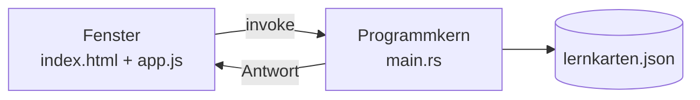

# K5 – Merkblatt

## Die zwei Teile



| Teil | Was er kann |
|---|---|
| **Fenster** (`index.html`, `style.css`, `app.js`) | was man sieht, was man anklickt |
| **Programmkern** (`main.rs`) | auf die Festplatte zugreifen |

Eine Webseite darf Dateien nicht schreiben, weil sie von einem fremden Server kommt. Eine installierte Anwendung darf es, weil sie bewusst installiert wurde.

## Die vorbereiteten Funktionen im Programmkern

| Funktion | Was sie tut |
|---|---|
| `karten_speichern(karten)` | schreibt die Liste als JSON in `lernkarten.json` |
| `karten_laden()` | liest die Datei; fehlt sie, gibt eine leere Liste zurück |

Der Name im JavaScript muss **exakt** zum Rust-Namen passen. Groß- und Kleinschreibung zählt.

## Das Rezept

| Wort | Rezeptregel |
|---|---|
| `invoke` | „Ruf den Programmkern" |
| `await` | „Warte, bis er fertig ist" |
| `async` | „Diese Funktion darf warten" |

> **Wo `await` steht, muss `async` davorstehen.**

```js
async function speichern() {
  await window.__TAURI__.core.invoke("karten_speichern", { karten: karten });
  console.log("gespeichert");
}
```

| Teil | Bedeutung |
|---|---|
| `window.__TAURI__.core.invoke` | die Tür zum Programmkern |
| `"karten_speichern"` | der Name der Funktion dort drüben |
| `{ karten: karten }` | die Daten, die mitgegeben werden – links der erwartete Name, rechts der Wert |

## Laden beim Start

```js
async function laden() {
  const geladen = await window.__TAURI__.core.invoke("karten_laden");
  for (const karte of geladen) {
    karten.push(karte);
  }
  listeAnzeigen();
}

laden();
```

> `listeAnzeigen()` **nicht vergessen** – sonst sind die Daten da, aber unsichtbar.
> `laden();` steht ohne `await` am Ende der Datei: Der Start soll nicht warten.

## Speichern an den richtigen Stellen

An jeder Stelle, an der sich die Daten ändern:

| Stelle | Nach was |
|---|---|
| Nach dem Anlegen einer Karte | eine Karte kam dazu |
| Nach dem Löschen einer Karte | eine Karte ist weg |
| Nach dem Ändern einer Karte | der Inhalt ist anders |

```js
await speichern();
```

Speichern an nur einer Stelle reicht nicht – gelöschte Karten kommen dann beim nächsten Start zurück.

## Die Datei finden

```nu
ls ~/.local/share/de.metarow.Lernkarten
open ~/.local/share/de.metarow.Lernkarten/lernkarten.json
```

Der Programmkern schreibt in den **Anwendungsdatenordner**, nicht in den Projektordner.

## Diagnose

| Beobachtung | Ursache |
|---|---|
| In der Konsole steht `Promise` statt der Liste | `await` vergessen |
| Fehlermeldung nennt `async` | `await` ohne `async` |
| Datei wird nicht gefunden | falscher Ordner – siehe oben |
| Daten sind da, aber unsichtbar | `listeAnzeigen()` nach dem Laden fehlt |
| Gelöschte Karten kommen zurück | nur an einer Stelle gespeichert |
| Nichts passiert | Command-Name falsch geschrieben |

## Verknüpfung

Leitfaden: [[K5 Daten behalten]] · Übungen: [[K5 Übungsblatt]] · [[Anhang Begleitung und Vorbereitung]]
Weiter mit [[K6 Feinschliff]] · zurück zu [[00 Kompaktkurs Tauri Grundlagen]]
