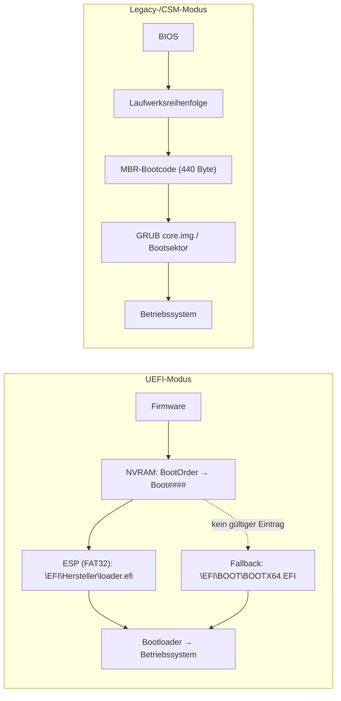

# UEFI-Booteinträge anlegen

Dieser Leitfaden zeigt, wie man Booteinträge für einen PC anlegt, prüft und repariert:

1. **aus einem laufenden Linux im UEFI-Modus** mit `efibootmgr`, abgegrenzt vom Legacy-Modus
2. **im BIOS-/UEFI-Setup selbst**, ersatzweise über die UEFI-Shell

> [!info] Kernaussage vorab
> Ein UEFI-Booteintrag ist **keine Datei auf der Platte**. Er ist eine Variable im **NVRAM des Mainboards** (`Boot0000`, `Boot0001`, … plus `BootOrder`). Der Eintrag zeigt auf eine `.efi`-Datei in der **EFI-System-Partition (ESP)** einer Platte.
> Daraus folgt:
> - Baut man die Platte in einen anderen PC, nimmt sie ihre Booteinträge **nicht** mit.
> - Löscht man den Eintrag, bleiben die Bootdateien auf der Platte erhalten.
> - **Im Legacy-Modus gibt es solche Einträge gar nicht.**

---

## 0. Grundlagen: UEFI und Legacy im Vergleich



| Merkmal | UEFI | Legacy (BIOS/CSM) |
|---|---|---|
| Was die Firmware startet | eine `.efi`-Datei aus der ESP | Bootcode im ersten Sektor (MBR) |
| Booteinträge | benannte Einträge im NVRAM (`Boot####`) | nur eine Reihenfolge der Laufwerke |
| Partitionstabelle | GPT (Standard) | MBR, oder GPT mit „BIOS boot“-Partition (GRUB) |
| Einträge aus Linux bearbeiten | `efibootmgr` | nicht möglich, nur Bootloader neu schreiben (`grub2-install --target=i386-pc`) |
| Rückfallebene | `\EFI\BOOT\BOOTX64.EFI` auf jeder ESP | nächstes Laufwerk in der Reihenfolge |
| Windows 10/11 auf GPT | bootet | bootet **nicht** |

> [!warning] Der Modus wechselt nicht während des Starts
> Ein im Legacy-Modus gestartetes GRUB kann **kein** UEFI-Windows starten (Chainloading geht nicht über die Modusgrenze). Umgekehrt startet ein UEFI-GRUB kein Legacy-System. Welcher Modus gilt, entscheidet die Firmware **beim Einschalten**. Im Mischmodus („UEFI + Legacy“) richtet sich das danach, welchen Eintrag man im Bootmenü wählt: Ein Eintrag mit dem Präfix „UEFI:“ startet im UEFI-Modus, einer ohne Präfix im Legacy-Modus.

---

## 1. Booteinträge aus einem laufenden Linux

### 1.1 Zuerst prüfen: Läuft das System im UEFI- oder im Legacy-Modus?

```nu
# Nushell
'/sys/firmware/efi' | path exists
```

```bash
# Bash
[ -d /sys/firmware/efi ] && echo "UEFI" || echo "Legacy/BIOS"

# Alternativen mit derselben Aussage
bootctl status 2>&1 | head -5     # Legacy: "Not booted with EFI"
efibootmgr                        # Legacy: "EFI variables are not supported on this system."
```

> [!important] Abgrenzung zum Legacy-Modus
> Ergibt die Prüfung **Legacy**, kann man von diesem Linux aus **keine** UEFI-Einträge anlegen. Der Kernel hat keinen Zugriff auf das NVRAM, und `/sys/firmware/efi/efivars` existiert nicht. Es gibt dann zwei Möglichkeiten:
> - ein Live-System **im UEFI-Modus** starten (im Bootmenü den Eintrag **„UEFI: <Stick>“** wählen) und dort weiterarbeiten
> - den Eintrag direkt im Setup anlegen (→ [[#2. Booteinträge im BIOS-/UEFI-Setup]])
>
> Taucht für einen Stick im Bootmenü **kein** „UEFI:“-Eintrag auf, ist UEFI-Boot in der Firmware abgeschaltet („Legacy only“).

**Woran man eine Legacy-Installation auf der Platte erkennt:**

```bash
lsblk -o NAME,SIZE,FSTYPE,PARTTYPENAME
# "BIOS boot" (ca. 1 MiB, ohne Dateisystem)  → GRUB für Legacy auf GPT
# "EFI System" (FAT32, 100 MiB–1 GiB)        → UEFI-Installation
# beides vorhanden                           → in beiden Modi bootfähig
```

### 1.2 Voraussetzungen im UEFI-Modus

- Linux läuft im UEFI-Modus (siehe 1.1).
- `efibootmgr` ist installiert. Bei Fedora (auch Atomic) ist es Standard, sonst `dnf install efibootmgr` bzw. `apt install efibootmgr`.
- Root-Rechte (`sudo`).
- Die Ziel-ESP und die `.efi`-Datei sind bekannt (siehe 1.4).

### 1.3 Einträge anzeigen und die Ausgabe lesen

```bash
efibootmgr -v
```

Beispielausgabe:

```text
BootCurrent: 0001
Timeout: 1 seconds
BootOrder: 0001,0000,0002
Boot0000* Windows Boot Manager  HD(1,GPT,3f1c2a9e-…,0x800,0x64000)/File(\EFI\Microsoft\Boot\bootmgfw.efi)
Boot0001* Fedora                HD(1,GPT,a71b0c44-…,0x800,0x12c000)/File(\EFI\fedora\shimx64.efi)
Boot0002  UEFI: PXE IPv4 Intel  PciRoot(0x0)/Pci(0x1f,0x6)/MAC(…)/IPv4(…)
```

| Feld | Bedeutung |
|---|---|
| `BootCurrent` | Eintrag, mit dem das laufende System gestartet wurde |
| `BootOrder` | Reihenfolge, in der die Firmware die Einträge versucht |
| `BootNext` | (falls vorhanden) Eintrag, der **nur beim nächsten Start** einmalig genutzt wird |
| `Boot0000*` | Eintragsnummer (hexadezimal). `*` = aktiv, ohne `*` = deaktiviert |
| `HD(1,GPT,<PARTUUID>,0x800,0x64000)` | Partition 1 einer GPT-Platte, erkannt an der **PARTUUID**. Dahinter Startsektor und Größe in Sektoren (hier 2048 und 409 600 = 200 MiB) |
| `File(\EFI\…)` | Pfad der `.efi`-Datei **innerhalb der ESP**, mit Backslashes. Neuere `efibootmgr`-Versionen zeigen ihn ohne `File(...)` |

> [!tip] Sicherung vor jeder Änderung
> ```bash
> efibootmgr -v > ~/efi-boot-$(date +%F).txt
> ```
> Damit lässt sich der alte Zustand jederzeit von Hand wiederherstellen.

### 1.4 Ziel ermitteln: Platte, ESP-Partitionsnummer und Datei

```bash
# Welche Partition ist die ESP? (PARTUUID zum Abgleich mit efibootmgr -v)
lsblk -o NAME,SIZE,FSTYPE,PARTTYPENAME,PARTUUID,MOUNTPOINTS

# Liegt die gewünschte .efi-Datei wirklich dort? (ESP ggf. kurz einhängen)
sudo mount -o ro /dev/sda1 /mnt
find /mnt/EFI -iname '*.efi'
sudo umount /mnt
```

Typische Loader-Pfade:

| System | Pfad in der ESP | Bemerkung |
|---|---|---|
| Windows | `\EFI\Microsoft\Boot\bootmgfw.efi` | Windows Boot Manager |
| Fedora / RHEL | `\EFI\fedora\shimx64.efi` | `shimx64.efi` statt `grubx64.efi`, wenn Secure Boot aktiv ist |
| Debian / Ubuntu | `\EFI\debian\shimx64.efi` bzw. `\EFI\ubuntu\shimx64.efi` | |
| systemd-boot | `\EFI\systemd\systemd-bootx64.efi` | |
| Fallback (jedes System) | `\EFI\BOOT\BOOTX64.EFI` | wird auch **ohne** NVRAM-Eintrag gefunden |

### 1.5 Eintrag anlegen

```bash
# Schema
sudo efibootmgr -c -d <PLATTE> -p <PARTNR> -L "<Name>" -l '<\Pfad\in\der\ESP.efi>'

# Beispiel: Windows Boot Manager auf SATA/USB-Platte, ESP = Partition 1
sudo efibootmgr -c -d /dev/sda -p 1 -L "Windows Boot Manager" -l '\EFI\Microsoft\Boot\bootmgfw.efi'

# Beispiel: Fedora auf NVMe, ESP = Partition 1
sudo efibootmgr -c -d /dev/nvme0n1 -p 1 -L "Fedora" -l '\EFI\fedora\shimx64.efi'
```

Die Optionen im Einzelnen:

- `-c`: Eintrag anlegen und **an die erste Stelle** der `BootOrder` setzen.
- `-C` (statt `-c`): nur anlegen, die Reihenfolge bleibt unverändert.
- `-d`: die **ganze Platte** (`/dev/sda`, `/dev/nvme0n1`), **nicht** die Partition. Die Option immer angeben: Ohne `-d` nimmt `efibootmgr` `/dev/sda` an.
- `-p`: Nummer der ESP auf dieser Platte (meist `1`).
- `-L`: Name, unter dem der Eintrag im Bootmenü erscheint.
- `-l`: Pfad **relativ zur ESP** mit **Backslashes**. In Bash und Nushell in einfache Anführungszeichen setzen, damit die Backslashes erhalten bleiben.

> [!note] Kontrolle
> Danach erneut `efibootmgr -v` aufrufen. Die PARTUUID im neuen Eintrag muss zur ESP aus `lsblk` passen.

### 1.6 Reihenfolge, einmaliger Start, Aktivieren und Löschen

```bash
sudo efibootmgr -o 0000,0001,0002   # BootOrder dauerhaft setzen
sudo efibootmgr -n 0000             # BootNext: nur der nächste Start mit 0000
sudo efibootmgr -N                  # BootNext wieder entfernen

sudo efibootmgr -b 0002 -A          # Eintrag 0002 deaktivieren (bleibt erhalten)
sudo efibootmgr -b 0002 -a          # wieder aktivieren
sudo efibootmgr -b 0003 -B          # Eintrag 0003 löschen
sudo efibootmgr -D                  # doppelte Einträge entfernen
```

> [!tip] Sicher testen mit `BootNext`
> Einen neuen Eintrag zuerst mit `-n` **einmalig** starten. Klappt das, setzt man ihn mit `-o` dauerhaft nach vorn. Klappt es nicht, startet der PC beim nächsten Mal automatisch wie bisher.

### 1.7 Nützliche Begleitbefehle

```bash
systemctl reboot --firmware-setup   # direkt ins BIOS-Setup neu starten (nur UEFI)
mokutil --sb-state                  # Secure Boot an oder aus?
bootctl status                      # Firmware, Secure Boot, aktueller Bootloader
sudo dmidecode -t bios -t system    # Hersteller, Modell, BIOS-Version
```

### 1.8 Typische Fehlerbilder

| Meldung / Verhalten | Ursache | Abhilfe |
|---|---|---|
| `EFI variables are not supported on this system` | System läuft im Legacy-Modus oder in einem Container | UEFI-Live-System starten, Container verlassen |
| `Read-only file system` | `efivarfs` ist schreibgeschützt eingehängt | `sudo mount -o remount,rw /sys/firmware/efi/efivars` |
| `Could not delete variable: Operation not permitted` | Variable ist mit dem Attribut „immutable“ geschützt | `sudo chattr -i /sys/firmware/efi/efivars/Boot0003-*` und erneut löschen |
| Eintrag ist nach dem Neustart verschwunden | Firmware entfernt Einträge ungültiger oder fehlender Platten. Manche Firmwares erlauben nur Einträge mit bestimmten Namen („Windows Boot Manager“) | Platte beim Start angeschlossen lassen, Eintrag im Setup anlegen (Teil 2) oder Fallback-Pfad nutzen |
| Eintrag ist da, startet aber nicht | falscher Pfad, falsche Partition, oder Secure Boot lehnt einen unsignierten Loader ab | Pfad mit `find` prüfen, bei Linux `shimx64.efi` verwenden |
| Reihenfolge springt zurück | Windows setzt sich nach Updates nach vorn, oder in der Firmware ist eine Sperre wie „Boot Order Lock“ (Lenovo) aktiv | Sperre im Setup lösen, Reihenfolge danach erneut setzen |

> [!example] Seitenblick: dasselbe unter Windows
> ```bat
> bcdedit /enum firmware
> bcdedit /set {fwbootmgr} displayorder {bootmgr} /addfirst
> shutdown /r /fw /t 0
> ```
> `bcdedit /enum firmware` listet die NVRAM-Einträge. Der zweite Befehl setzt den Windows Boot Manager an die erste Stelle. `shutdown /r /fw` startet direkt ins Firmware-Setup.

---

## 2. Booteinträge im BIOS-/UEFI-Setup

### 2.1 Setup und Bootmenü aufrufen

Die Taste muss direkt nach dem Einschalten gedrückt werden. Typische Belegungen:

| Hersteller | Setup | Einmal-Bootmenü |
|---|---|---|
| Dell | F2 | F12 |
| HP | F10 (oder Esc → Menü) | F9 |
| Lenovo ThinkPad / ThinkCentre | F1 | F12 |
| Lenovo IdeaPad | F2 oder Novo-Taste | F12 |
| Fujitsu | F2 | F12 |
| Acer | F2 | F12 |
| ASUS | Entf / F2 | F8 |
| MSI | Entf | F11 |
| Gigabyte | Entf | F12 |
| ASRock | F2 / Entf | F11 |

> [!tip] Ohne Tastenrennen
> - Linux (nur im UEFI-Modus): `systemctl reboot --firmware-setup`
> - Windows: `shutdown /r /fw /t 0` oder „Erweiterter Start“ → „UEFI-Firmwareeinstellungen“
>
> Mit aktiviertem „Fast Boot“ reagiert die Firmware oft gar nicht mehr auf Tasten. Dann bleibt nur einer der beiden Wege.

### 2.2 Den Bootmodus festlegen (UEFI, Legacy oder beides)

Bevor man Einträge anlegt, muss der Bootmodus zum System passen. Die Bezeichnungen unterscheiden sich je nach Hersteller:

| Hersteller / Firmware | Menüpunkt (typisch) | Werte |
|---|---|---|
| AMI Aptio (viele Boards, Fujitsu) | Boot → **CSM Support** / **Launch CSM** | Disabled = nur UEFI · Enabled = Mischmodus |
| ASUS | Boot → CSM → **Launch CSM** · Secure Boot → **OS Type** | „Windows UEFI Mode“ = nur UEFI |
| Dell | Boot Configuration → **Boot List Option** / **Enable Legacy Option ROMs** | UEFI / Legacy |
| HP Business | Advanced → Secure Boot Configuration | „Legacy Support Disable and Secure Boot Enable“ = nur UEFI |
| Lenovo | Startup → **UEFI/Legacy Boot** | UEFI Only · Legacy Only · Both (mit „UEFI first“) |

| Einstellung | Legacy-installiertes Linux | UEFI-Windows / UEFI-Linux |
|---|---|---|
| Legacy only | bootet | bootet nicht („kein bootfähiges Medium“) |
| Mischmodus, UEFI zuerst | bootet | bootet |
| UEFI only | bootet nicht | bootet |

> [!warning] Vor dem Umstellen auf „UEFI only“
> Prüfen, ob **alle** Systeme im PC eine ESP haben (siehe 1.1, `lsblk`). Ein im Legacy-Modus installiertes Linux startet danach nicht mehr. Secure Boot verlangt meist „UEFI only“. Im Mischmodus muss es in der Regel aus sein.

### 2.3 Eintrag im Setup anlegen

Viele Business-Geräte und AMI-Firmwares bieten einen Menüpunkt zum Anlegen eigener Einträge. Je nach Hersteller heißt er etwa:

- **„Add Boot Option“** / **„Add New Boot Option“**
- **„Boot Option Add“**
- **„Customized Boot“** (HP: eigener Pfad zu einer `.efi`-Datei)
- **„Boot from File“** (oft auch im Einmal-Bootmenü, für einen einmaligen Start)

Der Ablauf ist fast immer gleich:

1. **Name** eingeben, z. B. `Windows Boot Manager`. Er erscheint später im Bootmenü.
2. **Dateisystem bzw. Partition** auswählen. Die ESP erscheint meist als Gerätepfad wie `PciRoot(0x0)/Pci(…)/…/HD(1,GPT,…)` oder als „FS0“/„FS1“. Zu erkennen ist sie an Partition 1 und an dem Ordner `EFI`, den man beim Durchklicken sieht.
3. Zur **Datei** navigieren, z. B. `EFI` → `Microsoft` → `Boot` → `bootmgfw.efi`.
4. Speichern. Danach den neuen Eintrag in der **Bootreihenfolge** („Boot Option Priorities“, „Boot Sequence“) nach vorn schieben.
5. Mit **F10** (meist „Save & Exit“) speichern und neu starten.

> [!note] Kein „Add Boot Option“ vorhanden?
> Viele Consumer-Boards (ASUS, MSI, Gigabyte) und manche Lenovo-Geräte können keine eigenen Einträge anlegen. Sie listen nur, was sie selbst auf den Platten finden. Dann gibt es drei Wege:
> - **Fallback-Pfad:** Liegt `\EFI\BOOT\BOOTX64.EFI` auf der ESP, erscheint die Platte als „UEFI: <Plattenname>“ und lässt sich nach vorn schieben.
> - **`efibootmgr`** aus einem UEFI-Live-Linux (Teil 1).
> - **UEFI-Shell** (Abschnitt 2.4).

> [!info] Legacy-Modus im Setup
> Im Legacy-Modus legt man keine Einträge an. Man wählt nur die **Laufwerksreihenfolge**, oft unter „Hard Drive BBS Priorities“ oder „Legacy Boot Order“. Welches System dann startet, entscheidet der Bootcode im MBR dieser Platte bzw. das Menü von GRUB.

### 2.4 Ersatzweg: UEFI-Shell mit `bcfg`

Manche Firmwares haben eine eingebaute UEFI-Shell („Launch EFI Shell from filesystem device“). Sonst legt man sie als `\EFI\BOOT\BOOTX64.EFI` auf einen FAT32-Stick, etwa aus dem Paket `edk2-shell`. Bei Fedora liegt sie unter `/usr/share/edk2/ovmf/Shell.efi`.

```text
map -r                                   # Geräte neu einlesen, FS0:, FS1: … anzeigen
fs0:                                     # auf Dateisystem 0 wechseln
ls \EFI\Microsoft\Boot\bootmgfw.efi      # ist das die richtige ESP?

bcfg boot dump -v                        # vorhandene Einträge anzeigen
bcfg boot add 0 fs0:\EFI\Microsoft\Boot\bootmgfw.efi "Windows Boot Manager"
bcfg boot mv 3 0                         # Eintrag 3 an Position 0 verschieben
bcfg boot rm 3                           # Eintrag an Position 3 löschen
reset                                    # Neustart
```

Bei `bcfg boot add` gibt die Zahl die **Position** in der Bootreihenfolge an (`0` = ganz vorn).

---

## 3. Spickzettel

| Aufgabe | Linux (UEFI) | Setup / UEFI-Shell |
|---|---|---|
| Modus prüfen | `'/sys/firmware/efi' \| path exists` | Menü „Boot Mode“ / „CSM“ |
| Einträge anzeigen | `efibootmgr -v` | Boot → Boot Option Priorities · `bcfg boot dump -v` |
| Eintrag anlegen | `efibootmgr -c -d /dev/sdX -p 1 -L "Name" -l '\EFI\…\x.efi'` | Add Boot Option · `bcfg boot add 0 fs0:\EFI\…\x.efi "Name"` |
| Reihenfolge setzen | `efibootmgr -o 0000,0001` | Boot Sequence · `bcfg boot mv` |
| einmalig starten | `efibootmgr -n 0000` | Einmal-Bootmenü (F12/F11/F8) |
| Eintrag löschen | `efibootmgr -b 0003 -B` | Delete Boot Option · `bcfg boot rm` |
| ins Setup neu starten | `systemctl reboot --firmware-setup` | – |

---

## 4. Fallbeispiel: Windows-SSD meldet „kein bootfähiges Medium“

> [!example] Ausgangslage
> - Windows 11 ist auf einer GPT-SSD im UEFI-Modus installiert (ESP 200 MiB, MSR, NTFS, WinRE).
> - Auf dem Ziel-PC meldet die Firmware „kein bootfähiges Medium“, obwohl nur diese SSD angeschlossen ist.
> - Das Fedora auf dem PC ergibt `'/sys/firmware/efi' | path exists` → `false`.
>
> **Diagnose:** Der PC startet im Legacy-Modus. Die Firmware sucht Bootcode im MBR und findet auf der GPT-SSD nur den leeren Schutz-MBR. Die Bootdateien auf der ESP sind intakt; in einer UEFI-VM (OVMF) startet die SSD problemlos.
>
> **Lösung:** Im Setup den Mischmodus einstellen (CSM an, UEFI zuerst) oder „UEFI only“, wenn kein Legacy-System mehr gebraucht wird. Danach erscheint die SSD als „Windows Boot Manager“ oder „UEFI: <SSD>“. Fehlt der Eintrag, legt man ihn nach 2.3, 2.4 oder 1.5 an.
>
> Die SSD selbst lässt sich vorab in einer VM prüfen: [[13-winpe-rettungs-vm]].

---

## Quellen und weiterführend

- [[02-Legacy-zu-UEFI bei Fedora Atomic]] – eine Legacy-Installation nachträglich auf UEFI umstellen
- [[13-winpe-rettungs-vm]] – Windows-SSD in einer UEFI-VM starten
- `man efibootmgr` · `man bootctl`
- [Arch Wiki: Unified Extensible Firmware Interface](https://wiki.archlinux.org/title/Unified_Extensible_Firmware_Interface) (Abschnitte zu `efibootmgr` und UEFI-Shell/`bcfg`)
- [Arch Wiki: EFI system partition](https://wiki.archlinux.org/title/EFI_system_partition)
- [Microsoft Learn: BCDBoot-Befehlszeilenoptionen](https://learn.microsoft.com/de-de/windows-hardware/manufacture/desktop/bcdboot-command-line-options-techref-di)
