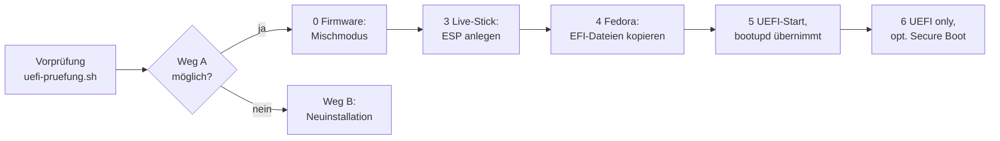

# Fedora Atomic von Legacy auf UEFI umstellen

Ein im Legacy-Modus installiertes Fedora Atomic lässt sich **ohne Neuinstallation** auf UEFI umstellen: Man legt nachträglich eine EFI-System-Partition (ESP) an, kopiert die signierten EFI-Dateien aus dem System-Image hinein und lässt `bootupd` die neue Komponente übernehmen. Grundlagen zu UEFI-Booteinträgen: [[01-UEFI-Booteinträge anlegen]].

> [!warning] Stand
> Der Ablauf ist mit Testplatten (Loop-Device) und gegen den Quellcode von bootupd 0.3.2 geprüft, **auf echter Hardware noch nicht durchgeführt**. Stand der einzelnen PCs: [[Schulungs-PCs – Stand der Umstellung]].



## Typische Ausgangslage

| Partition | Größe | Inhalt |
|---|---|---|
| `sdX1` | 1 MiB | BIOS boot (Legacy-GRUB auf GPT) |
| `sdX2` | 2 GiB | ext4, `/boot` – gemeinsam für BIOS und UEFI |
| `sdX3` | Rest | btrfs `fedora_fedora`, `/sysroot` |

Keine ESP, kein freier Platz am Ende.

## 1. Vorprüfung

Nur lesende Befehle, **direkt auf dem Host** – in einer Toolbox fehlen bei `lsblk` die Dateisystem-Angaben, und `bootupctl` sieht das Host-System nicht.

Systemplatte über `/boot` bestimmen, denn Gerätenamen wechseln zwischen Starts und Rechnern:

```bash
lsblk -no PKNAME $(findmnt -no SOURCE /boot)     # Bash, z. B. sdb
```

```nu
^lsblk -no PKNAME (^findmnt -no SOURCE /boot | str trim)   # Nushell
```

Alle Prüfpunkte sammelt das Skript [[_resources/uefi-pruefung.sh|uefi-pruefung.sh]] in eine Datei `~/uefi-pruefung_<Mainboard>_<Host>_<Datum>.txt`:

```bash
bash uefi-pruefung.sh                 # Systemplatte automatisch über /boot
bash uefi-pruefung.sh /dev/sdb        # Platte vorgeben (z. B. im Live-System)
bash uefi-pruefung.sh --smart         # + SMART aller Platten (Silverblue: über Fedora-Container)
bash uefi-pruefung.sh --smart-long    # + SMART-Langtest der Systemplatte (wartet)
```

Das Skript bricht in einer Toolbox ab, ignoriert dmidecode-Platzhalter („System manufacturer“, „To be filled by O.E.M.“) und nimmt bei Eigenbau-PCs das Mainboard in den Dateinamen. Meldungen wie `command not found` sind selbst ein Befund und landen absichtlich mit in der Datei.

### Bewertung der Pflichtpunkte

| Punkt | Befehl | Günstig | Ungünstig |
|---|---|---|---|
| 2 Partitionstabelle | `sudo fdisk -l /dev/sdX` | `Disklabel type: gpt`, Partition „BIOS boot“ | `dos`: geht (ESP Typ `EF`), max. 4 primäre Partitionen |
| 3 Partitionen | `lsblk -o NAME,SIZE,FSTYPE,PARTTYPENAME,UUID,MOUNTPOINTS` | ext4 `/boot`, btrfs ohne `crypt` darunter | `crypto_LUKS`: Verkleinern aufwendig · leere FSTYPE-Spalte: Toolbox, auf dem Host wiederholen |
| 6 bootupd | `sudo bootupctl status` | `Component BIOS`, `Detected: EFI: unknown` / adoptable | `command not found`: keine automatischen EFI-Updates |
| 7 EFI-Dateien | `ls -R /usr/lib/efi/`, `rpm -q shim-x64 grub2-efi-x64` | `shimx64.efi`, `grubx64.efi` im Image (signiert) | fehlen: Weg B |

Ergänzend: Punkt 4 Platz (`sudo sfdisk -F`, `sudo btrfs filesystem usage /sysroot` – btrfs braucht 1 GiB Reserve), Punkt 9 Sicherung (`rpm-ostree status`, `flatpak list --app`, `sudo ostree admin config-diff`, `/var/home` extern gesichert), Punkt 10 SMART.

> [!tip] `parted` fehlt auf Silverblue
> Es gehört nicht zum Image. Stattdessen `sfdisk -F` und `blkid` je Partition (beides util-linux) – so macht es auch das Skript.

### Entscheidung

| Befund | Weg |
|---|---|
| GPT · BIOS boot · bootupd aktiv · EFI-Dateien im Image · keine Verschlüsselung | **A: Umbau** (unten) |
| EFI-Dateien oder bootupd fehlen · LUKS · MBR · Dateisystem beschädigt | **B: Neuinstallation** im UEFI-Modus nach vollständiger Sicherung |

Meldet `btrfs check` Fehler oder lässt sich btrfs in GParted nicht verkleinern: erst [[03-btrfs und SMART im Live-System prüfen]].

## 2. Weg A: Umbau

### Schritt 0: Firmware in den Mischmodus (ASUS P8B75, AMI Aptio)

F8 beim Start: Erscheint der Live-Stick doppelt (mit und ohne „UEFI:“), ist der Mischmodus schon aktiv. Sonst Entf → F7 (Advanced Mode) → Reiter **Boot**:

| Menüpunkt | Einstellung |
|---|---|
| CSM → Launch CSM | Enabled |
| CSM → Boot Devices Control | UEFI and Legacy OpROM |
| CSM → Boot from Storage Devices | Both, UEFI first |
| Secure Boot → OS Type | Other OS |

F10 speichert. **Im Mischmodus bleiben, bis Schritt 5 erfolgreich war** – sonst startet das Legacy-Fedora nicht mehr.

### Schritt 3: ESP anlegen (Live-Stick, GParted)

Arbeitsblatt zum Ausdrucken (Beispiel Dozenten-PC, INTENSO 476 GB): ![[_resources/Schritt-3-ESP-anlegen.pdf]]

1. Fedora-**Workstation**-Live-Stick (die Atomic-ISO ist nur ein Installer) über „**UEFI:** <Stick>“ starten, prüfen: `[ -d /sys/firmware/efi ] && echo UEFI`.
2. Platte an Größe, Modell und Partitionsfolge identifizieren – im Live-System heißt sie oft anders (der Stick wird `sda`). Bei zwei gleichen SSDs hilft nur das Label `fedora_fedora` bzw. der Disk identifier aus `sudo fdisk -l`.
3. `sudo dnf install -y gparted && sudo gparted` (braucht Netzwerk), Partitionen ggf. aushängen.
4. `sdX3` → Größe ändern: **Freier Platz danach 1024 MiB**, davor 0, an MiB ausrichten, anwenden.
5. Im freien Bereich neue Partition: primär, **fat32**, Bezeichnung `EFI`, anwenden; dann Markierungen → **esp**.
6. Kontrolle `sudo fdisk -l /dev/sdX`: `sdX4 … 1G EFI System`.
7. Ohne Stick neu starten – Fedora bootet weiter im Legacy-Modus, `lsblk` zeigt die neue `sdX4`.

> [!danger] Nur das Ende verschieben
> Den Anfang von `sdX3` nie verschieben: GParted müsste die ganze Partition umkopieren – langsam und riskant.

### Schritt 4: EFI-Dateien in die ESP (installiertes Fedora, Bash)

```bash
sudo mkdir -p /run/esp && sudo mount /dev/sdX4 /run/esp
sudo cp -r /usr/lib/efi/shim/*/EFI  /run/esp/
sudo cp -r /usr/lib/efi/grub2/*/EFI /run/esp/
sudo cp /usr/lib/bootupd/grub2-static/grub-static-efi.cfg /run/esp/EFI/fedora/grub.cfg
sudo cp /boot/grub2/bootuuid.cfg /run/esp/EFI/fedora/
sudo umount /run/esp
```

Die statische `grub.cfg` liest `bootuuid.cfg` und lädt die eigentliche Konfiguration vom gemeinsamen `/boot` – deshalb müssen Kernel und GRUB-Menü nicht doppelt gepflegt werden.

### Schritt 5: erster UEFI-Start und Übernahme durch bootupd

1. F8 → „**UEFI:** <SSD>“ wählen. Die Firmware startet den Fallback `\EFI\BOOT\BOOTX64.EFI` (shim); dessen `fbx64.efi` liest `BOOTX64.CSV` und legt den NVRAM-Eintrag **Fedora** selbst an. Ein `efibootmgr` aus dem Legacy-System ist dafür nicht nötig (und dort auch nicht möglich).
2. Im gestarteten System:

```bash
sudo bootupctl adopt-and-update
```

### Schritt 6: Firmware auf UEFI only

Erst jetzt CSM → Launch CSM **Disabled**. Optional Secure Boot: OS Type **Windows UEFI mode** (shim und GRUB sind von Fedora signiert).

## 3. Verifikation

```bash
[ -d /sys/firmware/efi ] && echo UEFI    # erwartet: UEFI
efibootmgr -v                            # erwartet: Fedora → \EFI\fedora\shimx64.efi
sudo bootupctl status                    # erwartet: Component EFI (zusätzlich BIOS)
```

Soll-Zustand zum Vergleich: ein im UEFI-Modus installierter PC mit ESP 600 MiB als `sda1` und `Component EFI`.

## Hintergrund und Entscheidungen

- **Hybrid statt Ersatz:** Die BIOS-boot-Partition bleibt. Bis Schritt 6 bootet die Platte in beiden Modi – Rückfallebene, falls der UEFI-Start scheitert.
- **ESP am Plattenende:** btrfs um 1 GiB zu verkleinern ist auf allen PCs unkritisch. Die 1-MiB-BIOS-boot-Partition ist als ESP zu klein.
- **Alternative bei nicht verkleinerbarem btrfs:** `/boot` (ext4, 2 GiB) um 1 GiB verkleinern und die ESP in die Lücke legen.
- **Firmware zuletzt umstellen:** „UEFI only“ vor einem erfolgreichen UEFI-Start sperrt das System aus.

> [!failure]- Verworfene Ansätze
> - `sudo bootupctl backend install --component EFI` auf dem laufenden System: bricht ab („invalid re-install attempted“), weil der BIOS-State schon existiert.
> - Nur `bootupctl adopt-and-update` ohne Schritt 4: aktualisiert in 0.3.2 lediglich Dateien, die **bereits** in der ESP liegen – die ESP muss vorher befüllt sein.
> - BIOS-boot-Partition in eine ESP umwandeln: mit 1 MiB zu klein.
> - `bootc switch`/`upgrade` bei Dateisystemfehlern: tauscht nur das (intakte) Image, der Fehler im Dateisystem bleibt.

## Offen

- [ ] Nach dem ersten echten Umbau prüfen, ob `adopt-and-update` die EFI-Komponente wie erwartet übernimmt (Ausgabe von `bootupctl status` hier nachtragen).
- [ ] Schritte 4 und 5 bei Bedarf als eigene Arbeitsblätter.

## Verwandt

- [[01-UEFI-Booteinträge anlegen]] – NVRAM, `efibootmgr`, Setup, UEFI-Shell
- [[03-btrfs und SMART im Live-System prüfen]]
- [[Schulungs-PCs – Stand der Umstellung]]
- [[Fedora Sway Atomic]]
- Quelle: [[2026-10-21 Windows-SSD und Legacy-zu-UEFI Umstellung]]
