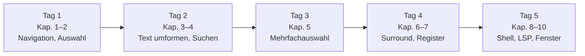

Ein Helix-Cookbook, nach Aufgaben sortiert statt nach Tasten: nummerierte Rezepte mit Tasten, Erklärung und wo sinnvoll einem Vorher/Nachher-Beispiel. Ergänzt [[01-Leitfaden zum Spickzettel|Helix-Leitfaden]], der dieselben Themen an den Grafiken des zweiseitigen Spickzettels erklärt – Konzept und Grafik dort, die konkrete Aufgabe hier.

> [!tip] Vor dem Start
> `~` oder `F1` zeigt in Helix selbst alle Tastenbelegungen der installierten Version. `hx --tutor` ist das eingebaute Grundkurs-Tutorial, [[helix-tutor-de]] die deutsche Fassung davon.

## Kapitel

| # | Kapitel | Stand |
|---|---|---|
| 1 | [[01 Navigation und Sprünge]] | fertig |
| 2 | [[02 Auswahl-Grundlagen]] | fertig |
| 3 | [[03 Text umformen]] | fertig |
| 4 | [[04 Suchen und Ersetzen]] | fertig |
| 5 | [[05 Mehrfachauswahl]] | fertig |
| 6 | Surround | offen – Grafik und Tabelle bleiben vorerst in [[01-Leitfaden zum Spickzettel#7 Match & Surround]] |
| 7 | [[07 Register und Makros]] | fertig |
| 8 | [[08 Shell-Integration]] | fertig |
| 9 | [[09 Code und LSP]] | fertig |
| 10 | [[10 Dateien, Buffer und Fenster]] | fertig |
| 11 | Markdown-Rezepte | offen – noch kein Ausgangsmaterial im Vault |
| 12 | Eigene Belegungen | offen – noch kein Ausgangsmaterial im Vault |
| 13 | [[13 Für Vim-Umsteiger]] | fertig |

Installation und Startkonfiguration (Windows, Quelltext-Bau): [[03-Installation]].

## Lernpfad



> [!tip] Lernempfehlung
> Pro Tag nur ein bis zwei Kapitel neben die Tastatur legen und die Rezepte bewusst nachspielen. Nach einer Woche sitzt die Grammatik „Auswahl → Aktion“.

## Übungsdatei

Diesen Text als `uebung.py` speichern und mit `hx uebung.py` öffnen:

```python
# Übung 1: Benenne "wert" überall in "betrag" um (Kapitel 4: Alles ersetzen)
wert = 10
print(wert)
summe = wert + wert

# Übung 2: Richte die Gleichheitszeichen aus (x x x, s = ⏎, &)
a = 1
abc = 2
ab = 3

# Übung 3: Setze "name" in Anführungszeichen (miw, ms")
print(name)

# Übung 4: Tausche die beiden Argumente (mi(, s \w+ ⏎, Alt-))
teile(zaehler, nenner)

# Übung 5: Sortiere die Zeilen alphabetisch (x x x x, | sort ⏎)
zitrone
apfel
melone
banane

# Übung 6: Nummeriere die Liste (C C C, "#P)
- punkt
- punkt
- punkt
- punkt
```

Lösungen zu Übung 4 und 6 stehen in [[05 Mehrfachauswahl]], zu Übung 1 in [[04 Suchen und Ersetzen]].

## Verwandt

- [[01-Leitfaden zum Spickzettel|Helix-Leitfaden]] – erklärt dieselben Themen an den Grafiken des Spickzettels
- [[03-Installation]] – Installation und Startkonfiguration
- [[Helix_Spickzettel_A4_erweitert.pdf]] – der Spickzettel selbst
- [[helix-tutor-de]] – deutsche Fassung des eingebauten `:tutor`
- [[Helix - Dash Cheat Sheets]] – vollständige, unkommentierte Befehlsreferenz zum Nachschlagen
