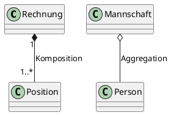

Beide Beziehungen beschreiben ein Ganzes und seine Teile. Im Diagramm sitzt jeweils eine **Raute am Ende beim Ganzen**: bei der Aggregation leer, bei der Komposition ausgefüllt.

Bei der **Komposition** ist das Ganze für Existenz und Speicherung seiner Teile verantwortlich:

- Ein Teilobjekt gehört zu höchstens **einem** Ganzen zur selben Zeit. Am Ende beim Ganzen darf die Multiplizität deshalb nicht größer als 1 sein.
- Wird das Ganze gelöscht, werden die Teilobjekte, die noch dazugehören, mit gelöscht.
- Ein Teil darf vorher herausgelöst werden, sofern das Modell es sonst erlaubt. Dann überlebt es.

Ein Beispiel ist eine Rechnung mit ihren Positionen: Ohne die Rechnung sollen die Positionen nicht weiterbestehen.

Bei der **Aggregation** (im Englischen *shared aggregation*) folgt aus der leeren Raute keine solche Regel. Was sie genau bedeutet, hängt laut Spezifikation vom Anwendungsgebiet und von der modellierenden Person ab. Wer sie verwendet, sollte im Team klären, was damit gemeint ist, etwa bei einer Mannschaft und ihren Mitgliedern, die auch ohne die Mannschaft bestehen.

In PlantUML schreibt man die Raute auf die Seite des Ganzen:

Soll eine Abhängigkeit der Teile ausgedrückt werden, genügt eine einfache Assoziationslinie nicht.

## Verbindungen

- [[UML-Diagramme beschreiben Struktur oder Verhalten]] – wo Klassendiagramme einzuordnen sind
- [[Software modellieren mit UML]] – Strukturzettel zu diesem Thema

## Quellen

- OMG: [Unified Modeling Language 2.5.1](https://www.omg.org/spec/UML/2.5.1/), Abschnitte zu Eigenschaften (`AggregationKind`) und zur Notation von Assoziationen
