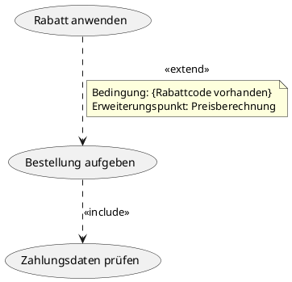

Im Anwendungsfalldiagramm verbinden `«include»` und `«extend»` zwei Anwendungsfälle. Beide sind gestrichelte Pfeile mit offener Spitze, sie zeigen aber in **entgegengesetzte Richtungen**.

**`«include»`:** Das Verhalten eines anderen Anwendungsfalls wird in den Basisfall eingefügt. Das dient vor allem dazu, Gemeinsames mehrerer Anwendungsfälle auszulagern. Der Basisfall braucht den eingebundenen Teil und ist ohne ihn meist nicht vollständig. Der Pfeil zeigt **vom Basisfall zum eingebundenen Fall**.

**`«extend»`:** Ein Anwendungsfall ergänzt einen anderen an festgelegten **Erweiterungspunkten**. Der erweiterte Fall ist unabhängig davon beschrieben und auch allein sinnvoll. Der Pfeil zeigt **von der Erweiterung zum erweiterten Fall**.

Die Bedingung bei `«extend»` ist **optional**. Fehlt sie oder ist sie beim Erreichen des ersten Erweiterungspunkts erfüllt, läuft die Erweiterung mit, andernfalls nicht. Bedingung und Erweiterungspunkte kann man in einer Notiz am Pfeil angeben.

Als Merkhilfe zeigt der Pfeil jeweils von dem Fall weg, der sich auf den anderen bezieht: Der Basisfall bindet ein, die Erweiterung erweitert.

Wird jede Bestellung geprüft, ist die Prüfung eingebunden. Eine Bestellung ohne Rabatt ist dagegen vollständig, der Rabatt ist deshalb eine Erweiterung.

## Verbindungen

- [[UML-Diagramme beschreiben Struktur oder Verhalten]] – das Anwendungsfalldiagramm gehört zu den Verhaltensdiagrammen
- [[Software modellieren mit UML]] – Strukturzettel zu diesem Thema

## Quellen

- OMG: [Unified Modeling Language 2.5.1](https://www.omg.org/spec/UML/2.5.1/), Kapitel 18 „UseCases“
